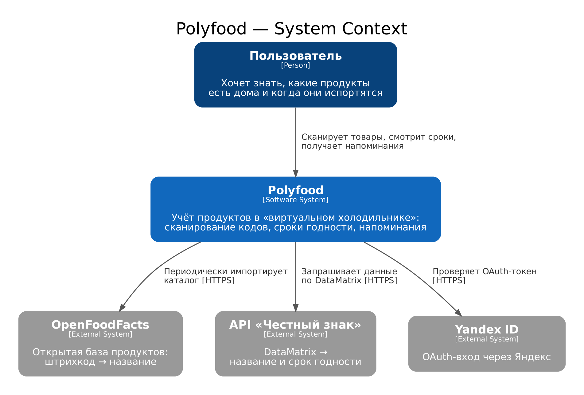
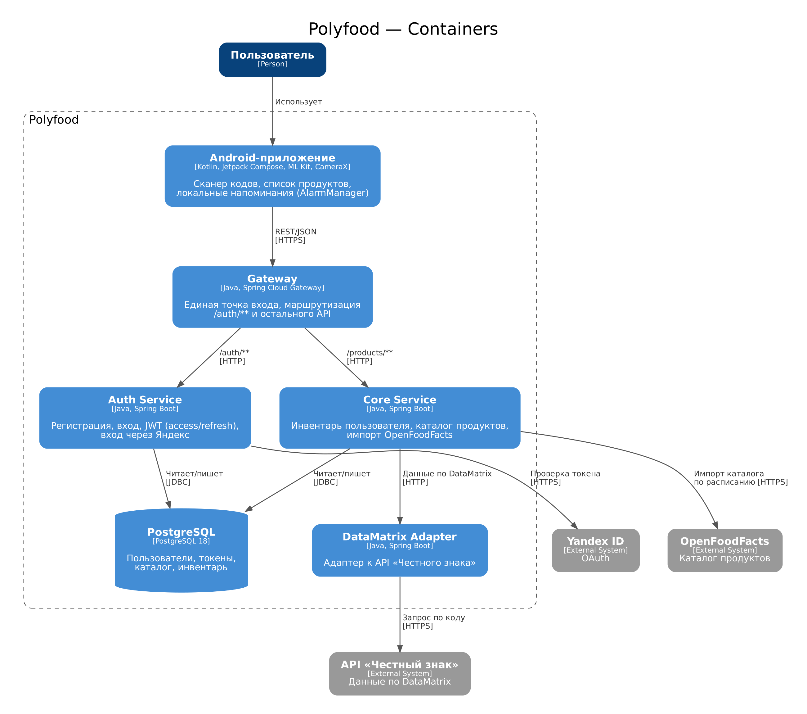
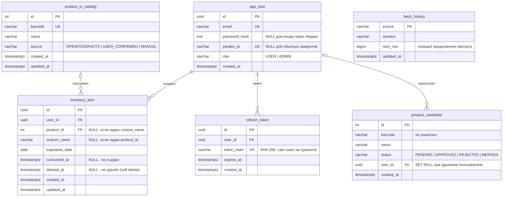

# **PolyShelf™**

## Состав команды
 - Денисов-Элерс Эдвин Феликсович, ак/гр 5130904/40103
 - Лиходиевский Андрей Максимович, ак/гр 5130904/40103
 - Николаев Артём Дмитриевич, ак/гр 5130904/40103
 - Парфенов Ярослав Михайлович, ак/гр 5130904/40103

## Стек
- БД - PostgreSQL 18 (миграции - Flyway)
- ЯП серверной части - Java 25, Spring Boot (микросервисы: gateway, core, auth, datamatrix-adapter), сборка Gradle
- UI - Android (Kotlin, Jetpack Compose, Kotlin Multiplatform-модуль `sharedLogic`)
- Внешние зависимости:
  - https://ru.openfoodfacts.org - получение названия продукта по штрих-коду. Каталог периодически (по cron) импортируется в нашу БД, поэтому сканирование штрихкода не зависит от доступности OpenFoodFacts в момент запроса.
  - API «Честного знака» (`mobile.api.crpt.ru`) - получение названия и срока годности по DataMatrix-коду (через сервис `datamatrix-adapter`).
  - Yandex ID (OAuth) - вход через Яндекс.

## Архитектурные решения и требования
### 1. Определение проблемы
Потребителям сложно контролировать сроки годности продуктов дома, из-за чего часть еды регулярно портится и выбрасывается, приводя к лишним финансовым тратам. Существующие способы ведения учета требуют долгого ручного ввода названий и множества дат по каждой упаковке, что отнимает много времени и приводит к отказу от регулярного отслеживания. В результате люди забывают о купленных товарах в холодильнике и не получают своевременных напоминаний о необходимости употребить продукт до истечения его срока годности.

### 2. Выработка требований
#### User`s Stories
1. Сканирование кода: Когда я разбираю покупки, я хочу отсканировать штрихкод (EAN) или DataMatrix-код товара, чтобы приложение само подтянуло название продукта (а по DataMatrix - и срок годности), избавляя меня от долгого ручного ввода. Если продукта нет в базе, я могу один раз ввести название сам, и оно сохранится для будущих сканирований.
2. Локальные напоминания: Когда у продукта в моем «виртуальном холодильнике» заканчивается срок годности, я хочу получить push-уведомление на телефон (даже без интернета), чтобы вовремя съесть еду и не выбрасывать испорченное. Время ежедневного напоминания я настраиваю сам.
3. Хранение данных о продуктах: Когда я захожу в приложение, я хочу видеть и знать сколько и какие продукты есть у меня и когда у них истекает срок годности, а также отмечать продукты съеденными или удалять их.

#### Оценка нагрузки и хранение:
 - Число пользователей: Ориентировочно 5000 пользователей в сутки. В среднем пользователь сканирует 35 товаров за неделю (около 25000 обращений к API в сутки).
 - Период хранения информации: Глобальный каталог (связка «штрихкод — название») хранится на сервере бессрочно (более 5 лет). Личные товары пользователей хранятся 2 года, так как редко какие-либо продукты хранятся более.

### 3. Разработка архитектуры и детальное проектирование
#### Характер нагрузки на сервис:
- Соотношение R/W (Read/Write) нагрузки: Около 80% / 20%. Основная масса запросов — это чтение (сканирование штрихкода для получения информации из базы). Запись происходит при добавлении продукта в личный инвентарь или добавлении неизвестного товара в общую базу.
- Объемы трафика: При 5000 DAU и 25 000 обращений к API в сутки, средняя нагрузка составит около 0.3 RPS, пиковая — до 3–5 RPS. Запросы и ответы представляют собой легковесный JSON, трафик составит не более 10–20 МБ в сутки.
- Объемы дисковой системы: Каталог продуктов (миллионы штрихкодов) займет порядка 14 ГБ. Данные инвентаря пользователей (5000 пользователей × 200 записей за 2 года) — еще около 200–300 МБ. Итоговая потребность с учетом индексов PostgreSQL составит не более 3–5 ГБ дискового пространства на 5 лет.

#### Диаграммы

##### C4, уровень 1 - System Context



##### C4, уровень 2 - Containers



Core проверяет JWT самостоятельно по публичному ключу (подпись выполняет только Auth), поэтому между сервисами нет синхронных обращений за авторизацией.

#### Схема базы данных



**Ключевые решения:**
- Товар с известным штрихкодом ссылается на каталог (`product_id`), товар без кода или с ещё неизвестным кодом хранит собственное имя (`custom_name`). Между ними действует `CHECK`: заполнено ровно одно из двух полей.
- Неизвестный штрихкод вместе с именем от пользователя попадает в `product_candidate` и в инвентарь. `barcode` там неуникален, чтобы разные пользователи могли предложить разные названия; уникальный каталог пополняется только после подтверждения.
- Удаление и «съедено» - мягкие (`deleted_at`, `consumed_at`), а не физические, что даёт историю и возможность отменить действие.
- `fetch_history` хранит позицию импорта OpenFoodFacts: после сбоя импорт продолжается с места остановки, а не с начала.

**Почему схема выдерживает нефункциональные требования:**
- Горячий путь (сканирование) - поиск по `barcode` с уникальным индексом `product_in_catalog_barcode_key`: B-tree по миллионам строк - это 3–4 чтения страниц, то есть доли миллисекунды. При нагрузке 0.3 RPS в среднем и 3–5 RPS в пике запас на порядки.
- Список инвентаря читается по `inventory_item_user_id_idx`, а частичный индекс `inventory_item_active_idx (user_id) WHERE consumed_at IS NULL AND deleted_at IS NULL` покрывает самый частый запрос - «активные продукты пользователя». У одного пользователя порядка 200 записей за 2 года, поэтому выборка не зависит от общего размера таблицы.
- Объём: каталог ≈ единицы ГБ вместе с индексами, инвентарь ≈ 200–300 МБ за 2 года, `refresh_token` чистится по `expires_at` (есть индекс). Это укладывается в оценку 3–5 ГБ на 5 лет, одного инстанса PostgreSQL достаточно.
- Целостность обеспечивается на уровне БД: внешние ключи, `ON DELETE CASCADE` для данных пользователя, `RESTRICT` для каталога, `CHECK` на роли, статусы и источники, уникальность email и Yandex-ID.
- Пароль и refresh-токены хранятся только в виде хэшей.

#### Контракты API

**Авторизация (`/auth`)**

| Метод | Путь | Назначение | Успех | Ошибки |
|---|---|---|---|---|
| POST | `/auth/register` | Регистрация по email и паролю | 201, токены | 400, 409 `EMAIL_TAKEN` / `EMAIL_BOUND_TO_YANDEX` |
| POST | `/auth/login` | Вход | 200, токены | 401, 409 `EMAIL_BOUND_TO_YANDEX` |
| POST | `/auth/yandex` | Вход/регистрация через Яндекс (опционально `link_password` для привязки к существующему аккаунту) | 200, токены | 401 `YANDEX_TOKEN_INVALID` / `INVALID_PASSWORD`, 409 `YANDEX_LINK_REQUIRED` / `EMAIL_TAKEN` |
| POST | `/auth/refresh` | Обновление пары токенов по refresh-токену | 200, токены | 401 |
| POST | `/auth/change-password` | Задать или сменить пароль | 204 | 401, 403 |

Ответ с токенами: `{ "access_token", "refresh_token", "token_type": "Bearer", "expires_in": 1800 }`. Access-токен живёт 30 минут, refresh-токен - 30 дней.

**Продукты (`/products`)**

| Метод | Путь | Назначение | Успех | Ошибки |
|---|---|---|---|---|
| POST | `/products/from-datamatrix` | Добавить продукт по DataMatrix; тело `{ "code" }` | 201, `Product` | - |
| POST | `/products/from-barcode` | Добавить по штрихкоду; тело `{ "code", "expiration_date" }` | 201, `Product` | 404 `{ "status": "NOT_FOUND", "code" }` - кода нет в каталоге |
| POST | `/products/from-barcode-candidate` | Добавить код, которого нет в каталоге; тело `{ "code", "name", "expiration_date" }` | 201, `Product` | - |
| POST | `/products` | Добавить продукт без кода; тело `{ "name", "expiration_date" }` | 201, `Product` | - |
| GET | `/products/inventory?sort=` | Список продуктов пользователя. Поля сортировки: `expirationDate`, `createdAt`, `updatedAt`, `consumedAt` | 200, `InventoryItem[]` | 400 - недопустимое поле сортировки |
| PUT | `/products/{id}/consumption` | Отметить съеденным (идемпотентно) | 204 | 404 |
| DELETE | `/products/{id}/consumption` | Снять отметку «съедено» (идемпотентно) | 204 | 404 |
| DELETE | `/products/{id}` | Удалить продукт из инвентаря | 204 | 404 |

Пример `InventoryItem`:
```json
{
  "id": "acde070d-8c4c-4f0d-9d8a-162843c10333",
  "name": "Молоко",
  "expiration_date": "2026-10-20",
  "consumed_at": null,
  "created_at": "2026-10-13T14:30:00Z",
  "updated_at": "2026-10-13T14:30:00Z"
}
```

**Ожидаемые нефункциональные требования на время отклика** (p95, при нагрузке до 5 RPS, без учёта сетевой задержки до клиента):

| Группа методов | Целевое время |
|---|---|
| `GET /products/inventory`, `PUT/DELETE .../consumption`, `DELETE /products/{id}`, `POST /products`, `POST /products/from-barcode`, `POST /products/from-barcode-candidate` (только БД) | ≤ 200 мс |
| `/auth/login`, `/auth/register`, `/auth/change-password` (хэширование пароля) | ≤ 500 мс |
| `/auth/refresh` | ≤ 200 мс |
| `POST /products/from-datamatrix`, `POST /auth/yandex` (синхронный вызов внешнего API) | ≤ 3 с |

Ограничение на `from-datamatrix` и `/auth/yandex` задаётся внешними сервисами; при их недоступности сервер возвращает ошибку, а не «подвисает». Доступность - не менее 99% в месяц.

#### Схема масштабирования сервиса (оценка при росте в 10 раз):
В текущей версии вся инфраструктура развернута на одном сервере через базовый docker-compose. При росте нагрузки в 10 раз (до 50 000 пользователей и пиковых 30–50 RPS) потребуется миграция на распределенную архитектуру:

 - Миграция в Kubernetes и балансировка: Отказ от docker-compose в пользу полноценной оркестрации через Kubernetes. Java-бэкенд будет масштабироваться горизонтально (поднятие 2–3 stateless-реплик приложения), а входящий трафик начнет распределяться через Ingress-контроллер или внешний балансировщик (Nginx/HAProxy).
 - Кэширование: В кластер между бэкендом и БД будет добавлен Redis. В нем начнут кэшироваться ответы от OpenFoodFacts и наиболее популярные штрихкоды, чтобы минимизировать сетевые задержки и снизить нагрузку на внешнее API.
 - Масштабирование базы данных: PostgreSQL будет переведен из одиночного контейнера в режим Master-Slave. Master-узел будет обрабатывать запись в инвентарь пользователей, а Read-реплика возьмет на себя массовое чтение каталога штрихкодов. Для эффективного управления сетевыми соединениями будет задействован Connection Pool (HikariCP).

### 4. Написание кода и тестирование
Репозитории: серверная часть - [`backend`](https://github.com/polyshelf/backend), мобильное приложение - [`Mobile`](https://github.com/polyshelf/Mobile). 

**Тестирование (бэкенд):**
- Unit-тесты по модулям: `auth` (`AuthServiceTest`, `TokenServiceTest`, `DatabaseUserDetailsServiceTest`, `AuthControllerTest`, `YandexClientTest`), `core` (`InventoryServiceTest`, `ProductServiceTest`, `ProductCandidateServiceTest`, `OpenFoodFactsImportServiceTest`, `DatamatrixClientTest`, `HttpRetryExecutorTest` и др.), `gateway` (`GatewayRoutingTest`), `datamatrix-adapter` (`ExternalCatalogServiceTest`). Всего около 180 тестовых методов.
- Интеграционный тест `DatamatrixInventoryFlowIT` покрывает пользовательскую историю №1: поднимается весь стек (gateway, auth, core, datamatrix-adapter, PostgreSQL) в Testcontainers, «Честный знак» подменяется WireMock; пользователь регистрируется, сканирует DataMatrix, продукт появляется в инвентаре с правильным названием и сроком, отмечается съеденным и возвращается обратно. Проверяется и состояние БД.
- Запуск: `./gradlew test` (unit), `./gradlew :integration-tests:integrationTest` (интеграционные; нужен Docker). В CI - `.github/workflows/1-commit-build.yml`, проверки PR - `2-pr-check.yml`.

#### Скриншоты приложения

> Вставьте скриншоты командой ``. Рекомендуемый размер - ширина 300–360 px.

| Экран | Скриншот |
|---|---|
| Сканер штрихкода / DataMatrix (US-1) | <!--  --> `[ВСТАВИТЬ СКРИН]` |
| Список продуктов («виртуальный холодильник») (US-3) | <!--  --> `[ВСТАВИТЬ СКРИН]` |
| Push-уведомление об истекающем сроке (US-2) | <!--  --> `[ВСТАВИТЬ СКРИН]` |

### 5. Сборка и запуск
#### Серверная часть (docker compose)

Требования: Docker и Docker Compose v2.

1. Перейдите в каталог серверной части и создайте файл окружения:
   ```bash
   cd backend
   cp .env.example .env
   ```
   Задайте в `.env` как минимум `POSTGRES_PASSWORD`. Необязательные параметры: `GATEWAY_PORT` (по умолчанию 8080), `YANDEX_CLIENT_ID` (для входа через Яндекс), `EXTERNAL_PROXY_*` (прокси для обращения к «Честному знаку»).
2. Сгенерируйте пару JWT-ключей в каталоге `JWT_KEYS_DIR` (по умолчанию `./keys`). Auth подписывает токены приватным ключом, core проверяет публичным:
   ```bash
   mkdir -p keys
   openssl genpkey -algorithm RSA -pkeyopt rsa_keygen_bits:2048 -out keys/private.pem
   openssl rsa -pubout -in keys/private.pem -out keys/public.pem
   ```
3. Запустите всё одной командой (`TAG` - тег опубликованных образов из `ghcr.io/polyshelf`):
   ```bash
   TAG=latest docker compose up -d
   ```
   Порядок старта обеспечен `depends_on`: PostgreSQL → миграции Flyway → auth, datamatrix-adapter → core → gateway → Caddy.
4. Проверка: `curl http://localhost:8080/actuator/health` (при `GATEWAY_PORT=8080`). Swagger UI доступен на gateway.

> Для локального запуска всего стека из исходников (с локальной сборкой образов) используйте `docker-compose.local-full.yaml`: `docker compose -f docker-compose.local-full.yaml up --build -d`. Только БД и миграции для разработки: `docker compose -f docker-compose.local.yaml up -d`. В продуктовом compose-файле домен для HTTPS задаётся переменной `POLYSHELF_DOMAIN`.

#### Мобильное приложение (Android)

Требования: JDK 21, Android SDK (или Android Studio).

```bash
cd Mobile
./gradlew :androidApp:assembleDebug
```

APK появится в `androidApp/build/outputs/apk/debug/`. Адрес сервера задан в `sharedLogic/.../di/ClientModule.kt` (`BASE_URL`); для работы с локальным бэкендом замените его на адрес вашего gateway. Релизный APK собирается workflow `Build APK` (GitHub Actions).

#### Тесты
```bash
cd backend
./gradlew test                                   # unit-тесты
./gradlew :integration-tests:integrationTest     # интеграционные (нужен Docker)
```
